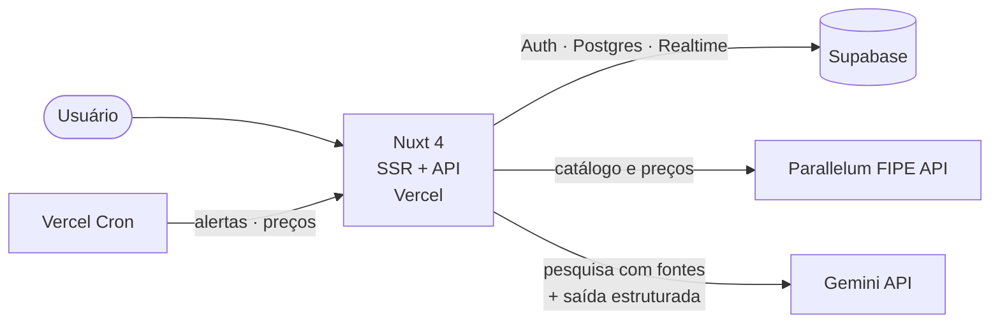

# vobs-car — Raio-X Técnico de Carros e Motos

Ficha técnica, fluidos, problemas crônicos, manutenção preventiva e custo real de propriedade de carros e motos em um só lugar, com um diagrama interativo que mostra onde cada modelo costuma dar problema.

> 🚧 **Status:** arquitetura e decisões técnicas documentadas; implementação em andamento a partir da Fase 0.

<!-- TODO: adicionar screenshots/GIF do Raio-X quando a Fase 2 estiver pronta -->

## Por que este projeto

As informações técnicas de um veículo estão espalhadas entre manuais, fóruns e vídeos: quanto óleo vai no motor, qual fluido de freio usar, que defeito aquele modelo costuma apresentar aos 80 mil km, quanto vai custar mantê-lo por ano. O vobs-car reúne tudo isso por modelo, motor e ano, **com as fontes citadas**.

## Funcionalidades

| Funcionalidade | Descrição | Fase |
|---|---|---|
| **Catálogo unificado** | Carros e motos pelo catálogo FIPE (marca → modelo → ano) | 1 |
| **Ficha técnica e fluidos** | Óleo (norma, viscosidade e volume), arrefecimento, freio, câmbio, velas, bateria, pneus (vazio/carregado) | 1 |
| **Problemas crônicos** | Defeitos recorrentes com gravidade, faixa de km, sintomas e prevenção | 1 |
| **Raio-X** | Diagrama SVG por sistema (motor, arrefecimento, transmissão, suspensão, freios, elétrica), colorido pela gravidade dos problemas | 2 |
| **Manutenção preventiva** | Plano por km **ou** tempo, com uso normal vs severo | 2 |
| **Custo de propriedade** | Estimativa mensal, anual e por km: depreciação, IPVA, licenciamento, combustível, manutenção e pneus | 2 |
| **Minha Garagem** | Veículos do usuário, histórico, km estimada e alertas de manutenção | 3 |
| **Pré-compra** | Checklist de vistoria focado nos pontos fracos do modelo + comparador de custos | 4 |

## Arquitetura



Destaques:

- **Dados por perfil técnico, não por versão FIPE:** versões com o mesmo motor e câmbio compartilham o mesmo conteúdo, o que reduz custo de IA e garante consistência.
- **IA com fontes e validação:** pesquisa com busca na web, estruturação em JSON Schema e validação com Zod; cada valor exibe sua fonte e seu nível de confiança.
- **Conteúdo versionado:** nada é sobrescrito; correções viram novas versões rastreáveis.
- **Geração assíncrona:** jobs com trava contra duplicidade e acompanhamento em tempo real via Supabase Realtime.
- **Cálculo de custo determinístico:** regras de IPVA por UF, histórico FIPE e preços da ANP, sem números inventados por IA.

Detalhes em [docs/ARCHITECTURE.md](docs/ARCHITECTURE.md), no [modelo de dados](docs/DATABASE.md) e no [design system](docs/DESIGN.md).

## Decisões técnicas (ADRs)

| ADR | Decisão |
|---|---|
| [0001](docs/adr/0001-stack.md) | Stack: Nuxt 4, Supabase e Vercel |
| [0002](docs/adr/0002-perfil-tecnico.md) | Perfil técnico como unidade de dados e cache |
| [0003](docs/adr/0003-conteudo-versionado.md) | Conteúdo gerado por IA versionado e imutável |
| [0004](docs/adr/0004-pipeline-ia.md) | Pipeline de IA em etapas, com fontes |
| [0005](docs/adr/0005-geracao-assincrona.md) | Geração assíncrona com jobs e trava |
| [0006](docs/adr/0006-acesso-restrito.md) | Acesso restrito por convite no MVP |
| [0007](docs/adr/0007-custo-de-propriedade.md) | Custo de propriedade por cálculo determinístico |
| [0008](docs/adr/0008-modelagem-veiculos.md) | Modelagem por tipo de veículo e motorização |
| [0010](docs/adr/0010-base-de-ui.md) | Base de UI: Reka UI e Tailwind CSS v4 com tokens próprios |
| [0011](docs/adr/0011-ambientes-na-nuvem.md) | Ambientes: Supabase só na nuvem, sem Docker |

## Stack

- **Front-end:** Nuxt 4, Vue 3 (Composition API), TypeScript, Pinia, Tailwind CSS v4, Reka UI
- **Back-end:** Nitro (rotas serverless na Vercel), Zod
- **Dados e auth:** Supabase (Postgres com RLS, Auth com Google, Realtime)
- **Integrações:** Parallelum FIPE API, Google Gemini API

## Estrutura do repositório

```text
app/        Front-end: páginas, componentes, composables, stores, SVGs do Raio-X
server/     Back-end: rotas (borda), services (negócio), repositories (dados)
shared/     Schemas Zod, tipos e funções puras usados no front e no back
supabase/   Migrations SQL com políticas RLS
docs/       Arquitetura, modelo de dados e ADRs
```

## Roadmap

- [x] Escopo, arquitetura, ADRs e modelagem de dados
- [ ] **Fase 0 — Fundação:** projeto Nuxt 4, Supabase na nuvem, login + allowlist, migrations base com RLS, deploy na Vercel
- [ ] **Fase 1 — Catálogo, ficha técnica e problemas crônicos**
- [ ] **Fase 2 — Raio-X, manutenção preventiva e custo de propriedade**
- [ ] **Fase 3 — Minha Garagem e alertas**
- [ ] **Fase 4 — Pré-compra, comparador e comunidade**
- [ ] Testes automatizados (Vitest, @nuxt/test-utils, Playwright)

## Rodando localmente

Pré-requisitos: Node.js 24 (versão em `.nvmrc`), pnpm e um projeto no Supabase.

```bash
pnpm install
pnpm dev          # http://localhost:3100

pnpm lint         # ESLint
pnpm typecheck    # vue-tsc
```

A configuração do Supabase será adicionada junto com a Fase 0.

## Aviso

Os dados técnicos são produzidos com auxílio de IA a partir de fontes públicas e podem conter erros. Confira sempre o manual do proprietário antes de qualquer manutenção.

## Licença

[MIT](LICENSE) © 2026 JJVOB

<!-- TODO: link do portfólio / LinkedIn -->
