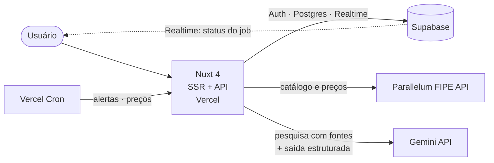
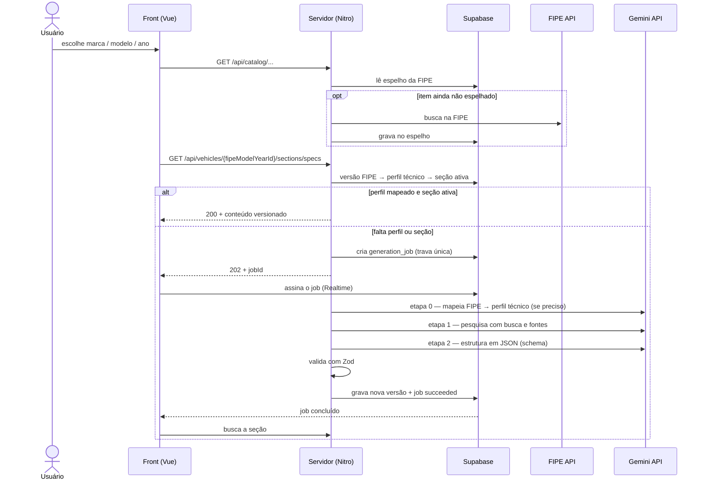

# Arquitetura — vobs-car

> Documento vivo. Decisões que mudam a arquitetura são registradas como ADRs em [`docs/adr/`](adr/). Modelo de dados em [`DATABASE.md`](DATABASE.md) e design system em [`DESIGN.md`](DESIGN.md).

## 1. Visão geral

O vobs-car é uma aplicação web para consultar, por modelo, motor e ano, as informações técnicas de **carros e motos**: fluidos e capacidades, problemas crônicos, plano de manutenção preventiva e custo estimado de propriedade.

O diferencial visual é o **Raio-X**: um diagrama SVG esquemático dividido por sistemas (motor, arrefecimento, transmissão, suspensão, freios, elétrica e carroceria), colorido pela gravidade dos problemas conhecidos do modelo.

Os dados técnicos são produzidos sob demanda por IA **a partir de fontes públicas citadas**, validados por schema, guardados de forma versionada e reaproveitados entre todas as versões FIPE que compartilham o mesmo conjunto mecânico.

## 2. Escopo e público

- **Público atual:** uso restrito por convite (autor e amigos), com login obrigatório — [ADR-0006](adr/0006-acesso-restrito.md).
- **Mercado:** Brasil (catálogo FIPE, IPVA por UF, preços de combustível da ANP).
- **Fora do escopo por enquanto:** acesso anônimo, SEO, monetização, app nativo.

## 3. Módulos

| Módulo | O que entrega | Fase |
|---|---|---|
| **Catálogo** | Seleção unificada de carros e motos (marca → modelo → ano) com espelho local da FIPE | 1 |
| **Ficha técnica** | Óleo (norma, viscosidade, volume), arrefecimento, freio, câmbio, velas, bateria, pneus (vazio/carregado), consumo | 1 |
| **Problemas crônicos** | Defeitos recorrentes com gravidade, faixa de km, sintomas, prevenção e custo estimado | 1 |
| **Raio-X** | Diagrama SVG por sistema, filtrando os dados e destacando zonas com problemas | 2 |
| **Manutenção preventiva** | Plano por km **ou** tempo (o que vier primeiro), uso normal vs severo, inspeção vs troca | 2 |
| **Custo de propriedade** | Estimativa mensal/anual e por km: depreciação, IPVA, licenciamento, combustível, manutenção, pneus | 2 |
| **Minha Garagem** | Veículos do usuário, hodômetro, histórico de manutenção/abastecimento, alertas | 3 |
| **Pré-compra** | Checklist de vistoria focado nos pontos fracos do modelo + comparador de custo entre veículos | 4 |
| **Comunidade** | Reporte de erro por campo e confirmação de problemas crônicos ("meu carro teve isso") | 4 |

## 4. Visão de contexto



## 5. Fluxo principal: consultar um veículo



Pontos-chave:

- O conteúdo pertence ao **perfil técnico** (motor + câmbio + geração), não ao código FIPE. Várias versões FIPE apontam para o mesmo perfil — [ADR-0002](adr/0002-perfil-tecnico.md).
- O conteúdo é **imutável e versionado**; não há regeneração por tempo — [ADR-0003](adr/0003-conteudo-versionado.md).
- Cada seção é gerada só quando aberta pela primeira vez, de forma assíncrona — [ADR-0005](adr/0005-geracao-assincrona.md).

## 6. Camadas e estrutura de pastas

```text
vobs-car/
├── app/                        # Front-end (Vue 3)
│   ├── app.vue
│   ├── assets/
│   │   ├── css/                # Design tokens (Tailwind v4 @theme)
│   │   └── svgs/               # Templates do Raio-X por categoria de carroceria
│   ├── components/
│   │   ├── common/             # Modais, botões, loaders, skeletons, estados vazios/erro
│   │   ├── vehicle/            # Ficha técnica, crônicos, manutenção
│   │   ├── xray/               # Diagrama interativo
│   │   ├── cost/               # Custo de propriedade e comparador
│   │   ├── garage/             # Garagem, hodômetro, alertas
│   │   └── pre-purchase/       # Checklist de vistoria
│   ├── composables/            # useVehicle, useGenerationJob, useOwnershipCost...
│   ├── layouts/
│   ├── middleware/             # auth.global.ts
│   ├── pages/                  # index, vehicle/[slug], compare, garage, pre-purchase
│   └── stores/                 # Pinia (sessão, garagem)
├── server/                     # Back-end (Nitro, serverless na Vercel)
│   ├── api/                    # Borda: validação Zod, autorização, mapeamento
│   │   ├── catalog/
│   │   ├── vehicles/
│   │   ├── jobs/
│   │   ├── garage/
│   │   └── cron/               # Protegidas por CRON_SECRET
│   ├── services/               # Regras de negócio e orquestração
│   │   ├── ai/                 # AiProvider + adapter Gemini + prompts versionados
│   │   ├── catalog/
│   │   ├── vehicle/
│   │   ├── jobs/
│   │   └── garage/
│   ├── repositories/           # Queries ao Supabase
│   └── utils/                  # Clientes, guards de auth, logger, erros
├── shared/                     # Código puro usado pelo front e pelo back
│   ├── schemas/                # Zod: contratos de API e saída da IA
│   ├── types/                  # Tipos inferidos + tipos gerados do Supabase
│   └── utils/                  # Cálculo de custo, plano de manutenção, km estimada
├── supabase/
│   ├── config.toml             # Configuração do Supabase local (Docker)
│   ├── migrations/             # SQL versionado (forward-only, com RLS)
│   └── seed.sql                # Dados de referência (UFs, regras de IPVA)
└── docs/                       # Arquitetura, banco e ADRs
```

Regras de dependência:

- `app/` nunca importa de `server/`; os dois podem importar de `shared/`.
- `server/api` → `server/services` → `server/repositories`, nunca o contrário. Services não conhecem `H3Event`.
- `shared/` contém apenas código puro: sem rede, banco ou segredos.

## 7. Pipeline de IA

Detalhes em [ADR-0004](adr/0004-pipeline-ia.md).

| Etapa | Quando | Entrada | Saída |
|---|---|---|---|
| 0 — Mapeamento | Versão FIPE sem perfil técnico | Descrição FIPE + ano + combustível | Chave técnica (motor, câmbio, geração, carroceria) |
| 1 — Pesquisa | Seção ainda não gerada para o perfil | Perfil técnico + seção | Texto + lista de fontes |
| 2 — Estruturação | Após a etapa 1 | Texto e fontes da etapa 1 + JSON Schema da seção | JSON validado com `safeParse` |

- O provedor fica atrás da interface `AiProvider` (`research`, `structure`); o Gemini é um adapter.
- Os prompts recebem apenas dados de catálogo validados, nunca texto livre do usuário.
- Falha de validação marca o job como `failed`; nada parcial é gravado.

## 8. Confiabilidade dos dados

Dados técnicos errados podem causar dano real ao veículo. Por isso:

- **Fontes:** toda seção guarda as fontes consultadas; cada valor referencia as fontes que o sustentam e a UI as exibe.
- **Envelope por valor:** `value`, `unit`, `sourceIds`, `confidence` (`high` | `medium` | `low`) e `verification` (`ai_unverified` | `community_confirmed` | `verified`).
- **Transparência do perfil:** a página mostra o motor e o câmbio considerados ("Ficha baseada no motor EA211 1.0 MPI + câmbio manual de 5 marchas"), para o usuário perceber um mapeamento errado.
- **Aviso permanente:** "Confira sempre o manual do proprietário".
- **Correção:** reporte de erro por campo (Fase 4) gera uma nova versão após revisão.

## 9. Raio-X

- Templates SVG **por categoria de carroceria**, não por modelo: hatch, sedã, SUV, picape, street, naked, esportiva, trail, scooter e custom. Arte própria, sem desenhos ou logos de montadoras.
- SVG embutido (inline) para permitir interação: cada zona é um `<g data-zone="engine">`, com o mesmo valor do enum `vehicle_system`.
- O componente recebe a contagem e a gravidade máxima dos crônicos por sistema e pinta as zonas (mapa de calor).
- Acessível: zonas focáveis por teclado, `role="button"` e `aria-label`.
- No celular, uma lista de sistemas em abas acompanha o diagrama, porque tocar em zonas pequenas é impreciso.

## 10. Manutenção preventiva e alertas

- Cada item do plano tem: chave estável, sistema, ação (`inspect` | `replace` | `adjust`), intervalo em km e em meses (o que vier primeiro) e intervalos para **uso severo**.
- A **km atual é estimada** pela média mensal das leituras de hodômetro, para os alertas funcionarem mesmo sem atualização frequente.
- Um cron diário calcula itens vencendo (por km estimada ou por data) e cria alertas, sem duplicar alertas já abertos.
- MVP: alertas dentro do app. E-mail ou web push (PWA) ficam para depois.

## 11. Custo de propriedade

Cálculo determinístico, sem IA, numa função pura em `shared/utils/` — [ADR-0007](adr/0007-custo-de-propriedade.md).

- Componentes: depreciação (histórico FIPE), IPVA (regra da UF), licenciamento, combustível (consumo × km × preço ANP), manutenção (plano + histórico real), pneus, seguro (informado) e reserva opcional para crônicos.
- Resultado em **faixa (mín–máx)**, mensal, anual e por km, com premissas editáveis.
- Para veículos flex, indica se compensa etanol ou gasolina com o consumo do próprio motor.

## 12. Segurança e privacidade

- **Acesso:** login Google + allowlist de e-mails; toda rota do servidor exige membro autenticado.
- **RLS em todas as tabelas.** Catálogo e conteúdo: leitura para membros, escrita só pelo servidor. Garagem: apenas o dono.
- **Segredos** (chave da IA, `service_role` do Supabase, `CRON_SECRET`) só no `runtimeConfig` privado do servidor.
- **IA:** recebe só dados públicos de veículos; nenhum dado de usuário é enviado.
- **LGPD:** dados mínimos (sem placa, sem CPF, sem IP); exclusão de conta remove os dados em cascata.
- **Proteção de cota:** um job ativo por perfil + seção e limite diário de gerações por usuário.

## 13. Operação

| Tema | Abordagem |
|---|---|
| Ambientes | Local (`nuxt dev` + Supabase local via Docker), preview (Vercel Preview + Supabase `dev`) e produção (Vercel + Supabase `prod`). A aplicação não é containerizada — [ADR-0009](adr/0009-ambientes.md). |
| Migrations | SQL versionado em `supabase/migrations/`, forward-only, aplicado na ordem local → dev → prod. Tipos TS gerados a partir do schema. |
| Cota da IA (free tier) | Geração sob demanda por seção, reaproveitamento por perfil, trava de job e limite diário. |
| Limite da FIPE | Espelho local do catálogo; sincronização preguiçosa (sob demanda) e preços mensais. |
| Duração das funções | Processamento com `waitUntil`; plano B: Supabase Edge Function com o mesmo contrato de job. |
| Pausa do Supabase free | O cron diário mantém o projeto de produção ativo. |
| Observabilidade | Logger central no servidor; `generation_jobs` registra status, erro e consumo de tokens. |

## 14. Roadmap

- [x] Escopo, arquitetura, ADRs e modelagem de dados
- [ ] **Fase 0 — Fundação:** projeto Nuxt 4, Supabase local via Docker + projetos dev/prod, login + allowlist, migrations base com RLS, lint/typecheck, deploy na Vercel
- [ ] **Fase 1 — Catálogo, ficha técnica e crônicos:** espelho FIPE, mapeamento para perfil técnico, pipeline de IA, jobs, página do veículo
- [ ] **Fase 2 — Raio-X, manutenção e custo de propriedade**
- [ ] **Fase 3 — Minha Garagem e alertas**
- [ ] **Fase 4 — Pré-compra, comparador e comunidade**
- [ ] Testes automatizados (Vitest, @nuxt/test-utils, Playwright) após a conclusão das funcionalidades

## 15. Decisões registradas (ADRs)

| ADR | Decisão | Status |
|---|---|---|
| [0001](adr/0001-stack.md) | Stack: Nuxt 4, Supabase e Vercel | Aceito |
| [0002](adr/0002-perfil-tecnico.md) | Perfil técnico como unidade de dados e cache | Aceito |
| [0003](adr/0003-conteudo-versionado.md) | Conteúdo gerado por IA versionado e imutável (sem TTL) | Aceito |
| [0004](adr/0004-pipeline-ia.md) | Pipeline de IA em etapas, com fontes, via Gemini | Aceito |
| [0005](adr/0005-geracao-assincrona.md) | Geração assíncrona com jobs e trava | Aceito |
| [0006](adr/0006-acesso-restrito.md) | Acesso restrito por convite no MVP | Aceito |
| [0007](adr/0007-custo-de-propriedade.md) | Custo de propriedade por cálculo determinístico | Aceito |
| [0008](adr/0008-modelagem-veiculos.md) | Modelagem por tipo de veículo e motorização | Aceito |
| [0009](adr/0009-ambientes.md) | Ambientes: Supabase local via Docker, app sem container | Aceito |
| [0010](adr/0010-base-de-ui.md) | Base de UI: Reka UI e Tailwind CSS v4 com tokens próprios | Aceito |
