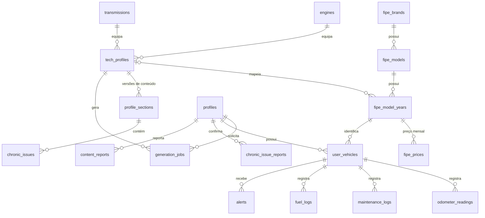

# Modelo de Dados — vobs-car

> Postgres no Supabase. Este documento descreve o modelo-alvo; a fonte da verdade são as migrations em `supabase/migrations/`. Contexto das decisões em [`ARCHITECTURE.md`](ARCHITECTURE.md) e [`adr/`](adr/).

## Convenções

- Nomes em `snake_case`, tabelas no plural.
- Chaves: `bigint generated always as identity` para catálogo e conteúdo; `uuid` para dados de usuário (não enumeráveis).
- Datas em `timestamptz` (eventos) ou `date` (datas de calendário).
- Dinheiro sempre em **centavos** (`integer`/`bigint`), nunca `float`.
- UF sempre no domínio `uf` (`char(2)` restrito às 27 siglas).
- **RLS habilitado em todas as tabelas**, com policies criadas na mesma migration da tabela.
- **Privilégios explícitos:** tabelas novas não ficam expostas automaticamente na API; cada migration concede (`GRANT`) apenas o necessário a `authenticated` e `service_role`. A role `anon` não recebe acesso.
- Migrations são **forward-only**: migration aplicada nunca é editada; correções viram nova migration.
- Tipos TypeScript gerados a partir do schema (`supabase gen types`) e usados em `shared/types/`.

## Diagrama



## Enums

| Enum | Valores |
|---|---|
| `vehicle_type` | `car`, `motorcycle` |
| `powertrain` | `ice`, `hybrid`, `phev`, `ev` |
| `fuel_type` (do veículo) | `gasoline`, `ethanol`, `flex`, `diesel`, `hybrid`, `electric` |
| `fuel_kind` (abastecimento/preço) | `gasoline`, `ethanol`, `diesel`, `gnv`, `electricity_kwh` |
| `aspiration` | `natural`, `turbo`, `supercharged` |
| `transmission_type` | `manual`, `automatic`, `cvt`, `dct`, `amt` |
| `final_drive` (motos) | `chain`, `belt`, `shaft`, `gear` |
| `body_type` | `hatch`, `sedan`, `suv`, `pickup`, `van`, `moto_street`, `moto_naked`, `moto_sport`, `moto_trail`, `moto_scooter`, `moto_custom` |
| `vehicle_system` | `engine`, `cooling`, `transmission`, `suspension`, `brakes`, `electrical`, `body` |
| `section_type` | `specs`, `chronic_issues`, `maintenance_plan`, `pre_purchase` |
| `content_status` | `draft`, `active`, `superseded`, `rejected` |
| `severity` | `low`, `medium`, `high` |
| `mapping_status` | `pending`, `mapped`, `failed` |
| `job_type` | `map_profile`, `generate_section` |
| `job_status` | `pending`, `running`, `succeeded`, `failed` |
| `usage_profile` | `normal`, `severe` |
| `alert_kind` | `maintenance_due`, `chronic_risk` |
| `alert_status` | `open`, `dismissed`, `done` |
| `report_status` | `open`, `accepted`, `rejected` |
| `user_role` | `member`, `admin` |

## 1. Catálogo (espelho da FIPE)

O catálogo é espelhado sob demanda para não depender do limite diário da API e para servir de base aos cálculos de custo. Cada lista é buscada na FIPE na primeira consulta e de novo quando passa do prazo: 30 dias para marcas, modelos e anos, 7 dias para o preço. As colunas `*_synced_at` guardam a última busca. Se a FIPE não responder, o servidor devolve o que já está no banco.

**`fipe_brands`**
| Coluna             | Tipo             | Notas                                        |
|---                 |---               |---                                           |
| `id`               | bigint PK        |                                              |
| `vehicle_type`     | vehicle_type     |                                              |
| `fipe_code`        | text             | Código da marca na FIPE                      |
| `name`             | text             |                                              |
| `synced_at`        | timestamptz      | Última vez que a marca veio na lista da FIPE |
| `models_synced_at` | timestamptz null | Última busca dos modelos da marca            |

Único: (`vehicle_type`, `fipe_code`).

**`fipe_models`**
| Coluna            | Tipo                    | Notas                             |
|---                |---                      |---                                |
| `id`              | bigint PK               |                                   |
| `brand_id`        | bigint FK → fipe_brands |                                   |
| `fipe_code`       | text                    |                                   |
| `name`            | text                    | Ex: "Gol 1.0 Mi Total Flex 8V 4p" |
| `synced_at`       | timestamptz             |                                   |
| `years_synced_at` | timestamptz null        | Última busca dos anos do modelo   |

Único: (`brand_id`, `fipe_code`).

**`fipe_model_years`** — a "versão FIPE" que o usuário seleciona.
| Coluna              | Tipo                           | Notas                                                            |
|---                  |---                             |---                                                               |
| `id`                | bigint PK                      |                                                                  |
| `model_id`          | bigint FK → fipe_models        |                                                                  |
| `fipe_year_code`    | text                           | Ex: "2020-1". O ano 32000 é como a FIPE marca o zero km          |
| `model_year`        | smallint null                  | `null` = zero km                                                 |
| `fuel`              | fuel_type                      | Lido do nome do ano na FIPE ("2020 Flex")                        |
| `fipe_vehicle_code` | text null                      | Código FIPE do veículo (ex: "005340-6"). Chega junto com o preço |
| `synced_at`         | timestamptz                    |                                                                  |
| `price_synced_at`   | timestamptz null               | Última consulta do preço                                         |
| `tech_profile_id`   | bigint FK null → tech_profiles | Preenchido pelo mapeamento                                       |
| `mapping_status`    | mapping_status                 | Default `pending`. Só fica `mapped` com o perfil preenchido      |

Único: (`model_id`, `fipe_year_code`). Índice: `tech_profile_id`.

**`fipe_prices`** — base para IPVA e depreciação.
| Coluna            | Tipo                         | Notas                 |
|---                |---                           |---                    |
| `id`              | bigint PK                    |                       |
| `model_year_id`   | bigint FK → fipe_model_years |                       |
| `reference_month` | date                         | Sempre o dia 1 do mês |
| `price_cents`     | bigint                       |                       |

Único: (`model_year_id`, `reference_month`).

## 2. Perfis técnicos

O perfil técnico é a unidade de conteúdo e cache ([ADR-0002](adr/0002-perfil-tecnico.md)): várias versões FIPE com o mesmo conjunto mecânico apontam para ele. Motor, câmbio e perfil são casados por chaves montadas a partir do resultado do mapeamento (`shared/utils/tech-profile-key.ts`). Quando a chave já existe, o registro é reaproveitado, e o primeiro a gravar vence.

**`engines`**
| Coluna            | Tipo            | Notas                                                                                        |
|---                |---              |---                                                                                           |
| `id`              | bigint PK       |                                                                                              |
| `slug`            | text único      | Fabricante + código + cilindrada + aspiração + motorização. Ex: `volkswagen-ea211-1-0-turbo` |
| `manufacturer`    | text            |                                                                                              |
| `code`            | text null       | Código do fabricante                                                                         |
| `displacement_cc` | integer null    | `null` só em elétricos                                                                       |
| `cylinders`       | smallint null   | `null` só em elétricos                                                                       |
| `aspiration`      | aspiration null | `null` só em elétricos                                                                       |
| `fuel`            | fuel_type       | `electric` só em elétricos. Nunca `hybrid`, que descreve a versão e não o motor              |
| `powertrain`      | powertrain      |                                                                                              |

O combustível fica fora do slug porque a FIPE chama o mesmo motor de "Flex" num ano e de "Gasolina" em outro, e isso dividiria um perfil em dois. A exceção é o diesel, que é sempre outro motor. A cilindrada entra arredondada: em litros com uma casa nos carros (1596 cc vira `1-6`) e em múltiplos de 10 cc nas motos.

**`transmissions`**
| Coluna        | Tipo              | Notas                                                                                 |
|---            |---                |---                                                                                    |
| `id`          | bigint PK         |                                                                                       |
| `slug`        | text único        | Tipo + código. Sem código: marca + tipo + marchas. Em motos, mais a transmissão final |
| `type`        | transmission_type |                                                                                       |
| `code`        | text null         | Ex: "DQ200", "DPS6"                                                                   |
| `gears`       | smallint null     | `null` só em CVT                                                                      |
| `final_drive` | final_drive null  | Apenas motos                                                                          |

Tabela própria porque problemas de câmbio atravessam modelos (o mesmo câmbio equipa vários carros). Com código, o câmbio é compartilhado entre marcas, como o DQ200 da VW e da Audi. Sem código, fica restrito à marca, porque "manual de 5 marchas" sozinho juntaria câmbios diferentes.

**`tech_profiles`**
| Coluna                    | Tipo                      | Notas                                                                        |
|---                        |---                        |---                                                                           |
| `id`                      | bigint PK                 |                                                                              |
| `normalized_key`          | text único                | Tipo + marca + família + geração + slug do motor + slug do câmbio            |
| `vehicle_type`            | vehicle_type              | Vem da versão FIPE                                                           |
| `body_type`               | body_type                 | Define o template SVG do Raio-X. As carrocerias `moto_*` só valem para motos |
| `brand_name`              | text                      | Nome da marca na FIPE                                                        |
| `family`                  | text                      | Ex: "Gol"                                                                    |
| `generation`              | text                      | Nome curto. Ex: "G6"                                                         |
| `year_start` / `year_end` | smallint / smallint null  | Anos-modelo da geração. `year_end` nulo: ainda em produção                   |
| `engine_id`               | bigint FK → engines       |                                                                              |
| `transmission_id`         | bigint FK → transmissions |                                                                              |
| `created_at`              | timestamptz               |                                                                              |

Índices: `engine_id` e `transmission_id`. O `slug` usado na URL entra com a página do veículo.

A função `map_model_year` grava o resultado de um mapeamento numa única transação: cria motor, câmbio e perfil se ainda não existirem e liga a versão FIPE ao perfil, com `mapping_status = 'mapped'`. O tipo de veículo e a marca do perfil vêm da própria versão, para não divergirem dela. Só o `service_role` executa a função. Quando a IA não identifica a versão ou responde fora do formato, nada é gravado e a versão fica com `mapping_status = 'failed'`.

## 3. Conteúdo versionado

[ADR-0003](adr/0003-conteudo-versionado.md): conteúdo é imutável; corrigir = criar nova versão.

**`profile_sections`**
| Coluna | Tipo | Notas |
|---|---|---|
| `id` | bigint PK | |
| `tech_profile_id` | bigint FK → tech_profiles | |
| `section` | section_type | |
| `version` | integer | Incrementa por perfil + seção |
| `status` | content_status | |
| `payload` | jsonb null | Validado pelo schema Zod da seção (vazio em `chronic_issues`, que usa linhas) |
| `sources` | jsonb | `[{ id, url, title, accessedAt }]` |
| `schema_version` | smallint | Versão do schema Zod |
| `prompt_version` | text | Versão do prompt usado |
| `ai_provider` / `ai_model` | text | |
| `job_id` | uuid FK → generation_jobs | |
| `created_at` / `activated_at` | timestamptz | |

Únicos: (`tech_profile_id`, `section`, `version`) e **parcial** (`tech_profile_id`, `section`) `WHERE status = 'active'` — garante uma única versão ativa.

**`chronic_issues`** — em linhas (e não em `jsonb`) porque são filtradas por sistema no Raio-X, alimentam alertas e o custo de propriedade e recebem confirmações da comunidade.
| Coluna | Tipo | Notas |
|---|---|---|
| `id` | bigint PK | |
| `profile_section_id` | bigint FK → profile_sections | Versão a que pertence |
| `tech_profile_id` | bigint FK → tech_profiles | Denormalizado para consulta |
| `key` | text | Chave estável entre versões (a geração recebe as chaves anteriores) |
| `title` | text | |
| `system` | vehicle_system | Zona do Raio-X |
| `severity` | severity | |
| `km_from` / `km_to` | integer null | Faixa típica de ocorrência |
| `symptoms` | text[] | |
| `prevention` | text | |
| `fix` | text | |
| `est_cost_min_cents` / `est_cost_max_cents` | integer null | Estimativa, rotulada como tal |
| `source_ids` | text[] | Referências a `profile_sections.sources` |

Único: (`profile_section_id`, `key`). Índice: (`tech_profile_id`, `system`).

### Contrato do payload (exemplo: `specs` de carro a combustão)

Cada valor usa o mesmo envelope ([ADR-0008](adr/0008-modelagem-veiculos.md)):

```jsonc
{
  "vehicleType": "car",
  "powertrain": "ice",
  "engineOil": {
    "viscosity":           { "value": "5W-30", "sourceIds": ["s1"], "confidence": "high", "verification": "ai_unverified" },
    "specification":       { "value": "API SP / VW 508.00", "sourceIds": ["s1", "s2"], "confidence": "medium", "verification": "ai_unverified" },
    "capacityWithFilter":  { "value": 4.0, "unit": "L", "sourceIds": ["s1"], "confidence": "high", "verification": "ai_unverified" }
  },
  "brakeFluid": { "specification": { "value": "DOT 4", "...": "..." } },
  "tires": {
    "size": { "value": "185/60 R15", "...": "..." },
    "pressure": { "front": { "empty": 30, "loaded": 32 }, "rear": { "empty": 30, "loaded": 36 }, "unit": "psi" }
  }
}
```

Os schemas vivem em `shared/schemas/` como `z.discriminatedUnion` por `vehicleType` e `powertrain`.

## 4. Jobs de geração

**`generation_jobs`**
| Coluna | Tipo | Notas |
|---|---|---|
| `id` | uuid PK | |
| `job_type` | job_type | |
| `fipe_model_year_id` | bigint FK null | Para `map_profile` |
| `tech_profile_id` | bigint FK null | Para `generate_section` |
| `section` | section_type null | |
| `status` | job_status | |
| `attempts` | smallint | Máx. 2 |
| `error` | text null | Mensagem técnica (sem dados sensíveis) |
| `usage` | jsonb null | Tokens de entrada/saída por etapa |
| `requested_by` | uuid FK → profiles | |
| `created_at` / `started_at` / `finished_at` | timestamptz | |

Índices:
- Único parcial (`tech_profile_id`, `section`) `WHERE status IN ('pending', 'running')` — trava contra geração duplicada.
- Único parcial (`fipe_model_year_id`) `WHERE job_type = 'map_profile' AND status IN ('pending', 'running')`.
- (`requested_by`, `created_at`) — contagem do limite diário por usuário.

## 5. Custo de propriedade

**`ipva_rules`**
| Coluna | Tipo | Notas |
|---|---|---|
| `id` | bigint PK | |
| `uf` | char(2) | |
| `year` | smallint | |
| `vehicle_type` | vehicle_type | |
| `fuel` | fuel_type null | `null` = qualquer combustível |
| `rate` | numeric(6,4) | Ex: 0.0400 |
| `exempt_after_years` | smallint null | Isenção por idade |
| `source_url` | text | |

Único `NULLS NOT DISTINCT`: (`uf`, `year`, `vehicle_type`, `fuel`).

**`licensing_fees`**
| Coluna | Tipo | Notas |
|---|---|---|
| `uf` / `year` / `vehicle_type` | PK composta | |
| `amount_cents` | integer | |
| `source_url` | text | |

**`fuel_prices`**
| Coluna | Tipo | Notas |
|---|---|---|
| `id` | bigint PK | |
| `uf` | char(2) | |
| `fuel` | fuel_kind | |
| `reference_date` | date | |
| `avg_price_cents` | integer | |
| `source` | text | `anp` ou `manual` |

Único: (`uf`, `fuel`, `reference_date`).

## 6. Usuários e garagem

**`allowed_emails`** — allowlist ([ADR-0006](adr/0006-acesso-restrito.md)). Sem acesso pelo cliente.
| Coluna | Tipo | Notas |
|---|---|---|
| `email` | text PK | Sempre minúsculo (`CHECK`) |
| `note` | text null | |
| `created_at` | timestamptz | |

**`profiles`** — criado pelo servidor no primeiro login de um e-mail autorizado. O cliente só edita `display_name` e `home_uf` (privilégio por coluna).
| Coluna | Tipo | Notas |
|---|---|---|
| `id` | uuid PK FK → auth.users | `ON DELETE CASCADE` |
| `display_name` | text | 1 a 80 caracteres |
| `home_uf` | uf null | Premissa padrão de custo |
| `role` | user_role | Default `member` |
| `created_at` | timestamptz | |

**`user_vehicles`**
| Coluna | Tipo | Notas |
|---|---|---|
| `id` | uuid PK | |
| `user_id` | uuid FK → profiles | `ON DELETE CASCADE` |
| `fipe_model_year_id` | bigint FK | |
| `tech_profile_id` | bigint FK null | Denormalizado |
| `nickname` | text | |
| `uf` | char(2) | |
| `usage_profile` | usage_profile | |
| `purchase_date` | date null | |
| `purchase_price_cents` | bigint null | |
| `insurance_annual_cents` | bigint null | |
| `created_at` / `archived_at` | timestamptz | |

Sem placa, chassi ou CPF (dados mínimos). A **km atual e a média mensal são derivadas** das leituras (view `user_vehicle_km_estimates`), não colunas.

**`odometer_readings`**: `id`, `user_vehicle_id`, `km`, `read_at`, `source` (`manual` | `maintenance` | `fuel`). Índice: (`user_vehicle_id`, `read_at desc`).

**`maintenance_logs`**: `id`, `user_vehicle_id`, `performed_at`, `km`, `plan_item_key` (null = serviço avulso), `description`, `cost_cents`, `workshop`, `notes`.

**`fuel_logs`**: `id`, `user_vehicle_id`, `filled_at`, `km`, `liters`, `fuel` (fuel_kind), `total_cents`, `full_tank` — permite calcular o consumo real.

**`alerts`**: `id`, `user_vehicle_id`, `kind`, `ref_key` (item do plano ou chave do crônico), `due_km`, `due_date`, `status`, `created_at`, `resolved_at`. Único parcial (`user_vehicle_id`, `kind`, `ref_key`) `WHERE status = 'open'` — o cron não duplica alertas.

## 7. Comunidade e pré-compra (Fase 4)

**`chronic_issue_reports`**: PK (`user_id`, `tech_profile_id`, `issue_key`), `experienced` (bool), `km_at`, `comment`, `created_at`. Referencia a **chave** do crônico, para sobreviver a novas versões.

**`content_reports`**: `id`, `user_id`, `tech_profile_id`, `section`, `field_path`, `message`, `status` (report_status), `created_at`.

**`pre_purchase_inspections`**: `id`, `user_id`, `fipe_model_year_id`, `answers` (jsonb), `notes`, `created_at`.

## 8. Políticas de acesso (RLS)

Função auxiliar `private.is_member()` (`security definer`): verdadeira se existe `profiles` para `auth.uid()`. Fica no schema `private`, que a API não expõe, como o Supabase recomenda para funções `security definer`.

| Tabelas | Leitura | Escrita |
|---|---|---|
| Catálogo, perfis técnicos, conteúdo, crônicos, regras de custo | `is_member()` | Apenas servidor (`service_role`) |
| `generation_jobs` | `requested_by = auth.uid()` (necessário para o Realtime) | Apenas servidor |
| `profiles` | Próprio registro | Próprio registro (campos editáveis) |
| `user_vehicles` | `user_id = auth.uid()` | `user_id = auth.uid()` |
| Filhas de `user_vehicles` | Dono via `exists` em `user_vehicles` | Dono via `exists` em `user_vehicles` |
| `chronic_issue_reports`, `content_reports`, `pre_purchase_inspections` | `user_id = auth.uid()` | `user_id = auth.uid()` |
| `allowed_emails` | Ninguém | Apenas servidor |
